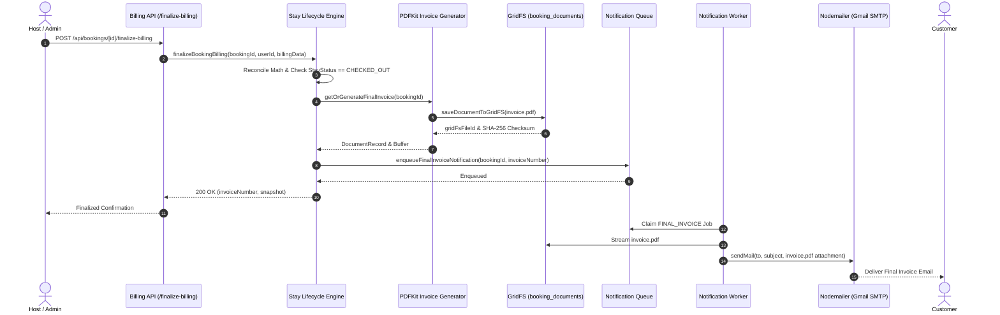

# Yatra Expertz — Booking Billing Finalization & Invoicing Guide

## 1. Overview

This guide details the financial finalization workflow, final invoice PDF generation, sequential numbering, GridFS storage, and delivery pipeline for **Yatra Expertz** ([https://www.yatraexpertz.com](https://www.yatraexpertz.com)).

---

## 2. Final Billing Snapshot

Billing finalization creates an immutable snapshot of all commercial charges, additional services, discounts, taxes, and settlements:

```typescript
export interface FinalBillingSnapshot {
  originalBookingAmount: number;
  roomCharges: number;
  additionalServices: AdditionalServiceItem[];
  discounts: number;
  taxesAndFees: number;
  totalInvoicedAmount: number;
  totalPaidAmount: number;
  outstandingBalance: number;
  supplierName: string;
  supplierGstin?: string;
  supplierAddress?: string;
  isGstTaxInvoice: boolean;
  paymentMethod?: string;
  transactionReference?: string;
  finalizedAt: Date;
  finalizedBy: string;
}
```

### 2.1 Mathematical Reconciliation Rules
Before finalizing billing, the engine verifies strict mathematical parity:

$$\text{CalculatedTotal} = \text{RoomCharges} + \sum \text{AdditionalServices} - \text{Discounts} + \text{TaxesAndFees}$$

$$\text{OutstandingBalance} = \max(0, \text{CalculatedTotal} - \text{TotalPaidAmount})$$

If the supplied total does not match within $\pm 0.01$, the operation fails with `BILLING_RECONCILIATION_ERROR`.

---

## 3. Legal Entity & Tax Classification

The document engine dynamically chooses the appropriate legal invoice classification:

1. **GST Tax Invoice (`TAX INVOICE`)**:
   - Issued **ONLY** when the property supplier possesses a verified, valid 15-character Indian GSTIN:
     `^[0-9]{2}[A-Z]{5}[0-9]{4}[A-Z]{1}[1-9A-Z]{1}Z[0-9A-Z]{1}$`
   - Displays CGST/SGST/IGST tax rates and breakdowns.
2. **Commercial Stay Invoice (`COMMERCIAL STAY INVOICE`)**:
   - Issued when the host is an unregistered supplier or homestay without GST registration.
   - Prevents fraudulent or misleading tax credit claims by business travelers.

---

## 4. Sequential Numbering

Final invoices use the monotonic sequence `YE-INV-YYYY-XXXXXX` generated via atomic MongoDB `$inc` operations:

```
YE-INV-2026-000001
YE-INV-2026-000002
YE-INV-2026-000003
```

Sequence counters are tracked in `document_sequences` per document type and calendar year.

---

## 5. Invoicing Workflow Lifecycle



---

## 6. Email Attachment & Fallback Architecture

- **Subject**: `Your Yatra Expertz Final Invoice — [YE-INV-YYYY-XXXXXX]`
- **Attachment**: Attached directly as `Yatra-Expertz-Invoice-YE-INV-YYYY-XXXXXX.pdf`.
- **Bounded Timeout**: 3,500ms generation timeout ensures that slow rendering never hangs worker threads.
- **Download Link**: Includes secure web link to download the PDF online at any time.
