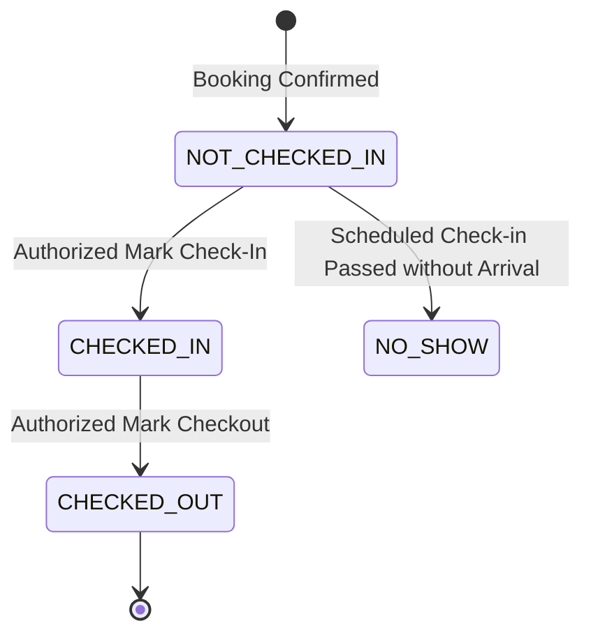

# Yatra Expertz — Booking & Stay Lifecycle Architecture

## 1. Executive Summary

This architecture document specifies the operational stay lifecycle and checkout engine for **Yatra Expertz** ([https://www.yatraexpertz.com](https://www.yatraexpertz.com)).

The architecture strictly distinguishes:
- **Booking Confirmation** (reservation secured) $\ne$ **Guest Arrival** (actual physical check-in).
- **Payment Completion** (money received) $\ne$ **Guest Checkout** (departure confirmed).
- **Guest Checkout** (room vacated) $\ne$ **Billing Finalization** (commercial reconciliation).
- **Booking Cancellation** (customer revoked) $\ne$ **No-Show** (customer failed to arrive).

---

## 2. Decoupled Lifecycle State Model

The system maintains distinct, orthogonal lifecycle dimensions to avoid conflating financial and operational states:



### 2.1 State Matrix

| Dimension | States | Governed By | Purpose |
|---|---|---|---|
| **Booking Status** | `pending`, `confirmed`, `cancelled`, `completed` | Core Booking Engine | Contractual state between guest and platform |
| **Payment Status** | `unpaid`, `partially_paid`, `paid`, `refunded` | Cashfree & Payment Gateway | Financial settlement state |
| **Stay Status** | `NOT_CHECKED_IN`, `CHECKED_IN`, `CHECKED_OUT`, `NO_SHOW` | Operational Stay Lifecycle | Physical presence at the property |
| **Billing Status** | `OPEN`, `PENDING_FINALIZATION`, `FINALIZED` | Billing Engine | Post-stay reconciliation & invoice state |

---

## 3. Operational Check-In Workflow

### 3.1 Authorization & Validation
- **Authorized Roles**: Platform Administrators (`role: "admin"`), Property Owners (`role: "owner"` verified against property ID).
- **Customers**: Strictly blocked with HTTP 403.
- **Pre-Conditions**:
  1. Booking must exist and have `bookingStatus === "confirmed"`.
  2. Booking must not be cancelled (`bookingStatus !== "cancelled"`).
  3. Booking must not already be checked out (`stayStatus !== "CHECKED_OUT"`).
- **Idempotency**: Repeated check-in calls return `{ success: true, alreadyCheckedIn: true }` without duplicate audit entries.

### 3.2 Side-Effects & Actions
1. Server records `actualCheckInAt: new Date()` (UTC timestamp).
2. Server records `checkedInBy: userId`.
3. Updates `stayStatus = "CHECKED_IN"`.
4. Atomically invalidates all pending arrival reminders (`REMINDER_48_HOURS`, `REMINDER_24_HOURS`, `REMINDER_2_HOURS`) via `cancelPendingNotificationsForBooking`.
5. Appends audit log entry (`GUEST_CHECK_IN`).

---

## 4. Operational Checkout Workflow

### 4.1 Authorization & Validation
- **Authorized Roles**: Administrators and authorized property owners.
- **Pre-Conditions**:
  1. Booking must be confirmed and uncancelled.
  2. Guest must have actually checked in first (`stayStatus === "CHECKED_IN"`).
  3. Guest must not already be checked out.
- **Non-Blocking Balances**: Checkouts are never blocked because an outstanding balance exists. If an outstanding balance remains, it is recorded accurately in `outstandingAmount`.

### 4.2 Side-Effects & Actions
1. Server records `actualCheckOutAt: new Date()` (UTC timestamp).
2. Server records `checkedOutBy: userId`.
3. Updates `stayStatus = "CHECKED_OUT"`.
4. Updates `bookingStatus = "completed"`.
5. Updates `billingStatus = "PENDING_FINALIZATION"` (if not already finalized).
6. Flags `reviewEligible = true` (Phase 6 foundation).
7. Asynchronously enqueues the `CHECKOUT_THANK_YOU` notification.
8. Appends audit log entry (`GUEST_CHECK_OUT`).

---

## 5. Expiration & Non-Automated Checkout Rule

> [!IMPORTANT]
> The passing of the scheduled checkout date/time **NEVER** automatically transitions a stay to `CHECKED_OUT` or `completed`.
> Automatic checkout risks billing errors, missed incidentals, and premature post-stay messaging. Actual departure must be explicitly confirmed by the authorized property host or administrator.

---

## 6. Audit Trail Architecture

All state transitions append immutable records to the booking's `auditLog` array:

```typescript
interface BookingAuditEntry {
  action: "GUEST_CHECK_IN" | "GUEST_CHECK_OUT" | "BILLING_FINALIZED";
  timestamp: Date;
  userId: string;
  details: Record<string, any>;
}
```
