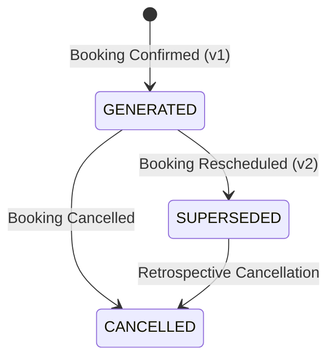

# Yatra Expertz — Booking Document Architecture & Lifecycle Specification

## 1. Executive Summary

This specification documents the server-side PDF document generation, sequential numbering, version control, and multi-channel delivery architecture implemented for **Yatra Expertz** ([https://www.yatraexpertz.com](https://www.yatraexpertz.com)).

The system provides high-fidelity, branded PDF documents directly from memory, stores them securely in an isolated GridFS bucket (`booking_documents`), and attaches them to transactional emails with bounded fallback deadlines, while keeping future WhatsApp document messaging prepared and dormant.

---

## 2. Document Types and Sequential Numbering

### 2.1 Monotonic Sequential Numbering

To satisfy Indian commercial and accounting requirements and prevent race-condition collisions, documents use monotonic sequential numbering via atomic MongoDB `$inc` operations on the `document_sequences` collection:

$$\text{NextNumber} = \text{findOneAndUpdate}(\{ \_id: \text{Key} \}, \{ \$inc: \{ \text{seq}: 1 \} \}, \{ \text{upsert}: \text{true} \})$$

| Document Type | Prefix | Format | Example | Purpose |
|---|---|---|---|---|
| `BOOKING_VOUCHER` | `YE-BV` | `YE-BV-YYYY-XXXXXX` | `YE-BV-2026-000001` | Initial booking confirmation voucher |
| `BOOKING_VOUCHER_RESCHEDULED` | `YE-BV` | `YE-BV-YYYY-XXXXXX` | `YE-BV-2026-000002` | Updated voucher upon date revision |
| `PAYMENT_RECEIPT` | `YE-PR` | `YE-PR-YYYY-XXXXXX` | `YE-PR-2026-000001` | Cashfree transaction payment receipt |
| `FINAL_INVOICE` | `YE-INV` | `YE-INV-YYYY-XXXXXX` | `YE-INV-2026-000001` | Post-checkout final commercial stay invoice |
| `CANCELLATION_CONFIRMATION` | `YE-CN` | `YE-CN-YYYY-XXXXXX` | `YE-CN-2026-000001` | Formal cancellation notice document |

### 2.2 Sequence Database Schema (`document_sequences`)

```typescript
interface DocumentSequence {
  _id: string;        // e.g. "BOOKING_VOUCHER_2026"
  documentType: DocumentType;
  year: number;
  seq: number;         // Monotonically increasing counter
  updatedAt: Date;
}
```

---

## 3. Metadata Storage Schema (`booking_documents`)

Document records are tracked in the `booking_documents` collection, decoupled from binary file storage:

```typescript
export interface BookingDocument {
  _id?: ObjectId | string;
  documentId: string;
  bookingId: string;
  customerId?: string;
  documentType:
    | "BOOKING_VOUCHER"
    | "BOOKING_VOUCHER_RESCHEDULED"
    | "PAYMENT_RECEIPT"
    | "FINAL_INVOICE"
    | "CANCELLATION_CONFIRMATION";
  documentNumber: string;
  documentVersion: number;
  bookingVersion: number;
  gridFsFileId: string;
  filename: string;
  mimeType: "application/pdf";
  fileSize: number;
  checksum: string; // SHA-256 hex digest
  generationStatus: "GENERATED" | "FAILED" | "SUPERSEDED" | "CANCELLED";
  failureReason?: string;
  generatedAt: Date;
  issuedAt: Date;
  supersededAt?: Date;
  cancelledAt?: Date;
  createdAt: Date;
  updatedAt: Date;
}
```

### 3.1 Recommended Indexes

1. `{ bookingId: 1, documentType: 1, generationStatus: 1 }`
2. `{ documentNumber: 1 }` (unique)
3. `{ gridFsFileId: 1 }`
4. `{ customerId: 1, createdAt: -1 }`

---

## 4. PDF Generation Architecture

### 4.1 In-Memory Buffer Pipeline

Documents are rendered in-memory using `pdfkit` without writing temporary files to disk:

```
[Authoritative Booking Data]
             │
             ▼
[data-builder.ts (Standardized Snapshot)]
             │
             ▼
[generateBookingVoucherPdf (PDFKit Stream)]
             │
             ▼
   [Buffer (In-Memory)]
             ├──► [SHA-256 Checksum Calculation]
             ├──► [GridFS Upload Stream (booking_documents)]
             └──► [Nodemailer Attachment Buffer]
```

### 4.2 Brand Design Guidelines

All generated documents adhere strictly to the Yatra Expertz design system:
- **Page Size**: Standard A4 (`595.28 pt x 841.89 pt`).
- **Brand Navy**: `#0f172a` (Primary headings, structural frame, top banner).
- **Brand Blue**: `#0b6dff` (Accent bars, badges, highlights).
- **Secondary Slate**: `#475467` (Body labels, subheadings).
- **Currency**: Clean Indian Rupee notation (`Rs. 18,500`), avoiding unsupported raw unicode symbols that produce PDF glyph warnings.
- **Header**: Includes official logo text `YATRA EXPERTZ`, tagline `"Har Yatra Banaye Yadgaar"`, and portal URL `https://www.yatraexpertz.com`.
- **Property Accuracy**: Real check-in and checkout times extracted from the property configuration (e.g. `2:00 PM` and `11:00 AM`).

---

## 5. Lifecycle & Rescheduling Invalidation



### 5.1 Rescheduling Rules
When a booking dates change:
1. All existing active vouchers (`BOOKING_VOUCHER` / `BOOKING_VOUCHER_RESCHEDULED`) with `generationStatus = "GENERATED"` are atomically transitioned to `SUPERSEDED`.
2. A new voucher of type `BOOKING_VOUCHER_RESCHEDULED` is generated with incremented `bookingVersion`.
3. The new voucher displays the banner `"STATUS: RESCHEDULED CONFIRMED"` with updated check-in/out dates.

### 5.2 Cancellation Rules
When a booking is cancelled:
1. All active vouchers for the booking are marked `CANCELLED`.
2. Any subsequent download attempt warns the user that the voucher has been voided.

---

## 6. Email Attachment & Bounded Timeout Strategy

To prevent PDF generation delays from blocking transactional email delivery:
1. Voucher generation is wrapped in an atomic `Promise.race` with a **3,500ms timeout**.
2. If generation succeeds within deadline, the PDF is attached to the confirmation email:
   ```typescript
   attachments: [{
     filename: `Yatra-Expertz-Booking-Voucher-${data.voucherNumber}.pdf`,
     content: voucherBuffer,
     contentType: "application/pdf"
   }]
   ```
3. If generation exceeds 3,500ms or fails, the email worker logs a warning and dispatches the plain HTML/text confirmation immediately, guaranteeing the customer receives their confirmation without delay.

---

## 7. WhatsApp Messaging Dormancy

WhatsApp document messaging is fully prepared at the template schema level, while preserving strict dormancy:
- `BOOKING_WHATSAPP_ENABLED=false` remains enforced.
- The WhatsApp adapter builds valid Meta Cloud API document payloads (`type: "document"`, `document.link`, `document.filename`), but blocks live HTTP requests and consumes zero retry attempts until explicit WhatsApp credentials are configured.
