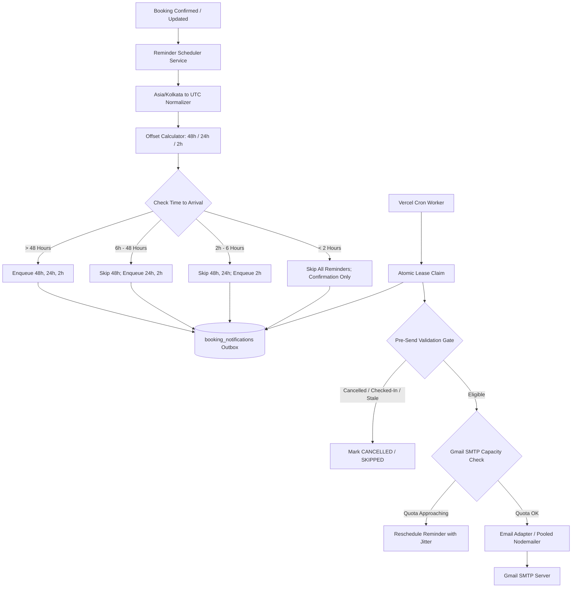

# Yatra Expertz — Booking Reminder & Scheduling Engine Architecture

## 1. Executive Summary

Phase 3 introduces an automated, resilient, multi-stage booking reminder system for **Yatra Expertz** (https://www.yatraexpertz.com). This architecture operates autonomously on top of the Phase 2 distributed outbox and Phase 2.1 communication channel engine, scheduling customer arrival reminders at **48 hours**, **24 hours**, and **2 hours** prior to scheduled check-in.

The engine features:
- **Exact Timezone Precision**: Calculates reminder timestamps using property-specific check-in times in `Asia/Kolkata` (IST, UTC+5:30) and persists triggers in strict UTC.
- **Dynamic Last-Minute Adaptation**: Intelligent offset filtering for same-day and last-minute bookings without sending inappropriate retroactive notifications.
- **Pre-Send Verification Gate**: Instant authoritative database validation immediately before dispatch, suppressing reminders for cancelled, completed, checked-in, or stale booking revisions.
- **Gmail SMTP Capacity Limiter**: Real-time daily quota monitoring reserving critical headroom for booking confirmations and cancellations over marketing/reminder emails.
- **Future-Ready Dormant WhatsApp Integration**: Complete parity between Email and WhatsApp channels, keeping WhatsApp jobs blocked safely until business verification and Meta credentials are provided.

---

## 2. Architecture Overview

---

## 3. Core Architectural Components

### 3.1 Date & Timezone Normalization (`reminders.ts`)
1. **Property-Specific Check-in Times**: Properties configure `checkInTime` (e.g., `"2:00 PM"`, `"14:00"`). If unconfigured, the system defaults to the business standard of `"12:00 PM"`.
2. **IST $\rightarrow$ UTC Conversion**: Because properties operate in India (`Asia/Kolkata`, UTC+5:30), the arrival datetime is converted to an absolute UTC epoch:
   $$\text{Checkin UTC} = \text{Date.UTC}(\text{Year}, \text{Month}, \text{Day}, \text{Hours}, \text{Minutes}) - 5.5 \times 3600 \times 1000$$
3. **Deterministic UTC Triggers**:
   - `REMINDER_48_HOURS`: Check-in UTC $- 48\text{ hours}$
   - `REMINDER_24_HOURS`: Check-in UTC $- 24\text{ hours}$
   - `REMINDER_2_HOURS`: Check-in UTC $- 2\text{ hours}$

### 3.2 Dynamic Last-Minute Booking Handling
To prevent confusing customers with obsolete reminders, the engine evaluates the difference between booking time ($\text{Now}$) and scheduled check-in:
- **Lead time $> 48\text{h}$**: All 3 reminder pairs (Email + WhatsApp) are scheduled as `PENDING`.
- **Lead time $6\text{h} - 48\text{h}$**: 48h reminders are recorded as `SKIPPED` with reason `REMINDER_TIME_ELAPSED`; 24h and 2h are scheduled as `PENDING`.
- **Lead time $2\text{h} - 6\text{h}$**: 48h and 24h reminders are recorded as `SKIPPED`; 2h is scheduled as `PENDING`.
- **Lead time $< 2\text{h}$**: All 3 reminders are recorded as `SKIPPED`; only the immediate booking confirmation is dispatched.

### 3.3 Reminder Expiration & Grace Windows
Each reminder carries a defined validity window:
- 48h Reminder expires when the 24h reminder becomes due.
- 24h Reminder expires when the 2h reminder becomes due.
- 2h Reminder expires **15 minutes after scheduled check-in**.
If delivery is delayed past the expiration timestamp (e.g., worker downtime), the pre-send validator skips the job with `REMINDER_DELIVERY_WINDOW_EXPIRED`.

---

## 4. Pre-Send Validation Gate

Before any notification is handed to the transport adapter, the processor revalidates the authoritative booking record in MongoDB:
1. **Booking Existence**: Booking document must exist.
2. **Booking Status**: If booking status is `cancelled`, the reminder is set to `CANCELLED`. If not `confirmed`, it is `SKIPPED`.
3. **Check-in Status**: If the guest has already checked in (`checkedIn: true` or `checkinStatus: "checked_in"`), arrival reminders are redundant and marked `SKIPPED` (`GUEST_ALREADY_CHECKED_IN`).
4. **Revision Match**: If `job.bookingVersion < booking.bookingVersion`, the reminder belongs to a superseded schedule and is marked `SKIPPED` (`STALE_BOOKING_REVISION`).
5. **Window Expiration**: If current time exceeds `job.expiresAt`, the reminder is marked `SKIPPED`.

---

## 5. Gmail SMTP Sending Capacity Controls

To protect the shared Google Workspace / Gmail SMTP sending reputation and respect daily volume thresholds (~500 emails/day standard limit):
- **Daily Quota Ceiling**: Default `SMTP_DAILY_LIMIT=450` emails per UTC calendar day.
- **Critical Message Reservation**: Booking Confirmations and Cancellations are categorized as `PRIORITY`.
- **Reminder Throttling**: Non-critical reminders are paused/deferred if sent count reaches 90% of daily capacity ($\ge 405$ emails/day). Deferral schedules a gentle exponential backoff with jitter to deliver during the next UTC day cycle.

---

## 6. WhatsApp Dormant Strategy

- The WhatsApp notification adapter mirrors the reminder schedule but adheres to `BOOKING_WHATSAPP_ENABLED=false`.
- All reminder jobs for WhatsApp are safely persisted with `status: "BLOCKED"` and `errorCode: "WHATSAPP_CREDENTIALS_MISSING"`.
- Jobs do not consume retry attempts and do not initiate external HTTP requests.
- When WhatsApp is activated in the future, historical blocked reminders are protected from replaying by checking `createdAt >= activationDate`.
