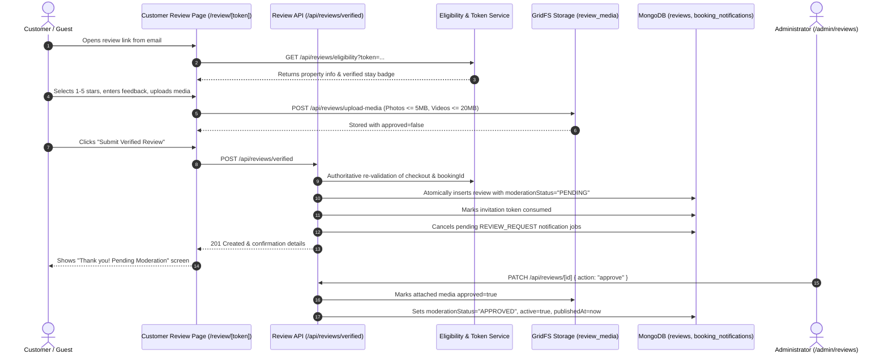

# Yatra Expertz — Verified Guest Review Architecture

## 1. Overview & System Intent
The Verified Guest Review & Social Proof Engine provides authoritative, tamper-proof customer reviews for Yatra Expertz. It ensures that only guests who have legitimately completed an actual stay at a property (`stayStatus === "CHECKED_OUT"`) can submit ratings, feedback, and verified media. Historical unverified testimonials remain backward-compatible but are never conflated with verified stays.

---

## 2. Review Eligibility Engine

A booking is eligible for a verified review **only** when server-side authoritative criteria are satisfied:

| Rule | Requirement | Verification Source |
|---|---|---|
| **Booking Existence** | Booking document must exist in MongoDB | `bookings.findOne({ _id })` |
| **Confirmed Status** | Booking must not be pending or failed | `bookingStatus !== "pending"` |
| **Actual Check-in** | Guest physical check-in must be recorded | `actualCheckInAt` exists |
| **Actual Checkout** | Guest physical checkout must be recorded | `actualCheckOutAt` exists & `stayStatus === "CHECKED_OUT"` |
| **Not Cancelled** | Stay must not have been cancelled | `bookingStatus !== "cancelled"` |
| **No-Show Excluded** | No-show stays cannot be reviewed | `stayStatus !== "NO_SHOW"` |
| **Property Association** | Review must match the booked property ID | `propertyId === booking.hotelId / homestayId` |
| **Single Review per Booking** | Exactly 1 review per booking | Unique partial index `{ bookingId: 1 }` |
| **Financial Independence** | Outstanding balance does NOT prevent review | Legitimate completed stays can review regardless of balance |

---

## 3. Review Data Model

The canonical `reviews` collection is extended to support comprehensive verified review fields while preserving full backward compatibility with legacy reviews:

```typescript
export interface VerifiedReview {
  _id?: ObjectId | string;
  bookingId?: string;             // Linked booking; enforced unique via partial index
  propertyId: string;             // Canonical hotel or homestay identifier
  propertyName: string;           // Display property title
  propertyCity?: string;          // City / Destination
  propertyState?: string;
  propertyType: string;           // "Hotel" | "Homestay" | "Resort"
  customerId?: string;            // User account ID if logged in
  userId: string;                 // User ID or guest reference
  verifiedStay: boolean;          // Authoritative flag: true only for completed stays
  reviewerDisplayName: string;    // Display name (e.g. "Rahul S.")
  userName: string;               // Backward compatibility alias
  reviewerAvatar?: string;
  userImage?: string;             // Backward compatibility alias
  overallRating: number;          // Integer 1 to 5
  rating: number;                 // Backward compatibility alias
  reviewTitle?: string;           // Review headline (max 100 characters)
  reviewText: string;             // Detailed written feedback (10 to 2,000 characters)
  recommendProperty?: boolean;    // Recommendation indicator (true / false)
  photos?: string[];              // Approved photo URLs
  videos?: string[];              // Approved video URLs
  reviewImages?: string[];        // Backward compatibility photo array
  media?: ReviewMediaItem[];      // Detailed media metadata (type, url, fileId, mime)
  moderationStatus: ModerationStatus; // "PENDING" | "APPROVED" | "REJECTED" | "HIDDEN"
  moderationReason?: string;      // Required for rejections and hiding
  moderatedBy?: string;           // Administrator username
  moderatedAt?: Date;             // Timestamp of moderation action
  submittedAt: Date;              // Guest submission timestamp
  publishedAt?: Date;             // Publication timestamp
  createdAt: Date;
  updatedAt: Date;
  active: boolean;                // Backward compatibility flag (true when APPROVED)
  verified: boolean;              // Backward compatibility flag (true when verifiedStay)
  featuredOnHomepage?: boolean;   // Admin flag for "Stories of Happy Journeys"
}
```

### Database Indexes
- Partial unique index: `{ bookingId: 1 }` with `{ partialFilterExpression: { bookingId: { $exists: true, $type: "string" } } }`
- Compound query index: `{ propertyId: 1, moderationStatus: 1, createdAt: -1 }`
- Homepage feature index: `{ featuredOnHomepage: 1, moderationStatus: 1 }`

---

## 4. Secure Guest Invitation Tokens

For customers who booked without registering an account, Yatra Expertz generates cryptographically signed review invitation tokens:

1. **HMAC-SHA256 Token Construction**:
   ```typescript
   payload = { bookingId, propertyId, guestEmail, expiresAt };
   token = base64url(payload) + "." + hmacSha256(base64url(payload), SECRET);
   ```
2. **Timing-Safe Verification**: Evaluated via `crypto.timingSafeEqual` to prevent side-channel timing attacks.
3. **Validity & Expiry**: Configurable expiration, defaulting to 30 days (`DEFAULT_EXPIRATION_DAYS = 30`).
4. **Token Consumption**: Opening the customer review page `/review/[token]` validates but does **not** consume the token. Submitting the review atomically records consumption in `review_tokens` and sets `bookingId` on the review.
5. **Revocation**: Supports administrative revocation via `revokeGuestReviewToken(bookingId, reason)`.

---

## 5. Review Submission Workflow



---

## 6. Property Rating Aggregation

Public property page ratings are dynamically aggregated across all approved reviews:

$$\text{Average Rating} = \frac{\sum_{i=1}^{N} \text{Rating}_i}{N}$$

$$\text{Recommendation Rate} = \frac{N_{\text{recommended}}}{N} \times 100\%$$

- **Total Reviews**: Count of all reviews where `moderationStatus === "APPROVED"` (or `active === true` for legacy).
- **Verified Count**: Subset of approved reviews where `verifiedStay === true`.
- **Rating Distribution**: Individual counts for 5★, 4★, 3★, 2★, and 1★.
- **Fairness Guarantee**: Moderation applies equally to positive and negative reviews. Legitimate negative reviews with 1★ or 2★ ratings cannot be rejected or modified simply due to low ratings.
